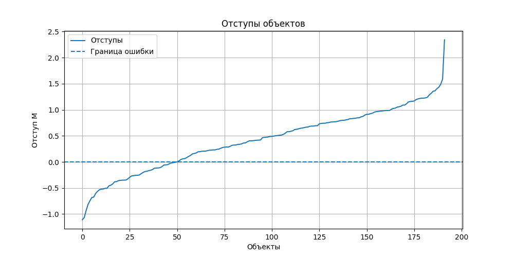
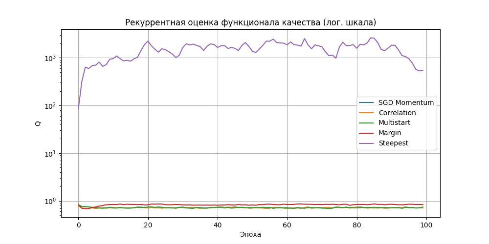

# Лабораторная работа №1. Линейная классификация

Канон обозначений — лекция 1 («Линейный классификатор», 08.09.2025):
выборка `X^l = {(x_i, y_i)}`, бинарные метки `y_i ∈ {-1, +1}`;
`a(x, w) = sign(Σ_j w_j f_j(x))`; нейрон `σ(Σ_j w_j f_j − w_0)`, `f_0(x) = −1`;
отступ `M_i(w) = g(x_i, w)·y_i`, `M_i < 0 ⇔` ошибка;
квадратичная потеря `Q(M) = (1−M)²`; риск `Q(w) = Σ_i L(w, x_i) → min_w` — СУММА без `1/l`;
SG: шаг `h`, забывание `λ`, `ξ_i := L(w, x_i)`, `w := w − h∇L`,
`Q := λξ + (1−λ)Q`, `Q` init — среднее `L` по случайному подмножеству, `λ` порядка `1/m`;
momentum `v := γv + (1−γ)L′`, `w := w − hv`;
init: `0` / `random(−1/2n, 1/2n)` / `w_j := <y,f_j>/<f_j,f_j>`;
порядок: shuffling, чаще брать при малом `M_i` и `|M_i|`, отсечения `μ_+`/`μ_−`;
скорейший спуск: `L(w−h∇L(w,x_i),x_i) → min_h` по ОДНОМУ объекту,
при квадратичной `h* = ||x_i||^{−2}`;
регуляризация `~L = L + τ/2·||w||² = … + τ/2·Σ_{j=1}^n w_j²` (по ВСЕМ `j`, без исключений),
`∇~L = ∇L + τw`, `w := w(1−hτ) − h∇L`, `τ` — коэф. регуляризации.

## Цель работы

Реализовать линейный бинарный классификатор и обучить его на реальном датасете
методом стохастического градиента и его эвристиками строго по лекции 1. В работе реализованы:

- вычисление отступа `M_i(w)`;
- квадратичная функция потерь по отступу `Q(M) = (1−M)²`;
- автоматическое вычисление градиента функции потерь;
- рекуррентная оценка функционала `Q := λξ + (1−λ)Q`;
- стохастический градиентный спуск с инерцией (`h`, `γ`);
- L2-регуляризация `τ/2·||w||²` внутри графа потерь (градиент содержит `τw`);
- скорейший градиентный спуск (`h* = ||x_i||^{−2}` по одному объекту);
- инициализации весов `0` / `random(−1/2n, 1/2n)` / точная дробь `<y,f_j>/<f_j,f_j>`;
- shuffling и вероятностное предъявление с предпочтением малых `M_i`/`|M_i|` и отсечениями `μ_+`/`μ_−`;
- сравнение собственной реализации с эталоном из `sklearn`.

## Структура проекта

```text
lab1/
├── README.md
├── margins.png
├── quality.png
└── source/
    ├── autograd.py
    ├── main.py
    ├── optimizers.py
    └── weights.py
```

Назначение файлов:

- `source/main.py` - основной исполняемый файл: загрузка данных, подготовка выборки, обучение моделей, оценка качества, построение графиков;
- `source/autograd.py` - минимальная реализация автоматического дифференцирования для операций, используемых в линейной модели (включая `sum` для риска-суммы);
- `source/optimizers.py` - оптимизатор `SGDMomentum` (`v := γv + (1−γ)∇~L`, `w := w − hv`; отдельного `τ`-члена нет, так как штраф уже в графе потерь);
- `source/weights.py` - функции инициализации весов `zeros_init`, `random_init`, `correlation_init`.

## Запуск

Запуск выполняется из директории `source`:

```bash
MPLBACKEND=Agg python3 main.py
```

Число эпох по умолчанию 100 (`LAB1_EPOCHS`), мультистарт — 10 запусков (`LAB1_MULTISTART_N`).
Датасет скачивается автоматически из внешнего источника (нужен интернет), хранить его в репозитории не требуется.

Использованные гиперпараметры (подобраны заново после перехода риска на сумму):

```text
h = 0.01, gamma = 0.9, tau = 0.001, lam = 1/l = 0.001736 (l = 576)
```

## Датасет

Использован датасет **Pima Indians Diabetes**:

```text
https://raw.githubusercontent.com/jbrownlee/Datasets/master/pima-indians-diabetes.data.csv
```

Задача - классификация наличия диабета по медицинским признакам.
Разбиение `train/test = 75/25` (`random_state=42`, стратифицировано), признаки стандартизированы
по обучающей выборке. Метки переведены в `y_i ∈ {-1, +1}`.

## Линейная модель

Реализована линейная решающая функция:

```text
g(x, w) = <w, x>
```

Классификатор:

```text
a(x, w) = sign(g(x, w))
```

Смещение реализовано через константный признак `f_0(x) = −1` по лекции
(первый столбец матрицы — `-1`, вес `w_0` — порог нейрона):

```python
X_train = np.column_stack((-np.ones(len(X_train)), X_train))
```

В коде:

```python
def g(X: Tensor, w: Tensor) -> Tensor:
    return X @ w

def a(X: Tensor, w: Tensor) -> np.ndarray:
    return np.where(g(X, w).data >= 0, 1.0, -1.0)
```

## Отступ объекта

Отступ объекта (лекция 1):

```text
M_i(w) = g(x_i, w) * y_i,   M_i(w) < 0 <=> ошибка на x_i
```

В коде:

```python
def M_i(X: Tensor, y: Tensor, w: Tensor) -> Tensor:
    return g(X, w) * y
```

Для лучшей собственной модели отступы анализируются на тестовой выборке. В результате последнего запуска:

```text
Ошибочные объекты (M < 0): 50
Правильные объекты (M > 0): 142
Минимальный отступ: -1.1085690765020215
Средний отступ: 0.4159620954629118
Максимальный отступ: 2.3410522263132907
```

График отступов сохраняется в `margins.png`.

## Функция потерь и эмпирический риск

Квадратичная потеря по отступу (лекция 1):

```text
L(w, x_i) = Q(M_i) = (1 - M_i)^2,   M_i = y_i * <w, x_i>
```

Эмпирический риск — СУММА без `1/l`:

```text
Q(w) = SUM_i L(w, x_i) -> min_w
```

В коде:

```python
def Q(X: np.ndarray, y: np.ndarray, w: Tensor) -> float:
    margins = y * (X @ w.data)
    return float(np.sum((1.0 - margins) ** 2))
```

Доля ошибок считается отдельной функцией `err_rate` (бинарная потеря) и риском `Q` не называется.

## Градиент функции потерь

Для вычисления градиента реализован небольшой механизм автоматического дифференцирования в `autograd.py`.

Поддерживаемые операции:

- сложение;
- унарный минус;
- умножение;
- матрично-векторное умножение;
- экспонента;
- логарифм;
- среднее значение;
- сумма (для риска-суммы и нормы `||w||²` внутри графа).

Объект `Tensor` хранит:

- `data` - численное значение;
- `grad` - градиент;
- `_prev` - родительские вершины вычислительного графа;
- `_op` - локальную функцию обратного распространения.

Градиент считается вызовом:

```python
xi.backward()
```

После этого градиент по весам доступен как `w.grad`.

## Рекуррентная оценка функционала качества

Экспоненциальное скользящее среднее (лекция 1):

```text
Q := lam * xi + (1 - lam) * Q,   xi := ~L(w, x_i)
```

Начальная оценка `Q` — среднее `~L(w, x_i)` по случайному подмножеству из 50 объектов
(лекция 1, шаг 2 SG), а не текущая потеря:

```python
def recursive_Q(previous_Q, xi, lam):
    if previous_Q is None:
        return xi
    return lam * xi + (1.0 - lam) * previous_Q
```

Темп забывания `lam = 1/l ≈ 0.001736` — порядка `1/m` по лекции.
График рекуррентной оценки (логарифмическая шкала) сохраняется в `quality.png`.

## L2-регуляризация

Штраф `τ/2·||w||²` считается ВНУТРИ графа потерь по ВСЕМ компонентам, включая `w_0`:

```python
def tilde_L(x_i: Tensor, y_i: Tensor, w: Tensor, tau: float) -> Tensor:
    margin = M_i(x_i, y_i, w)
    residual = 1.0 + (-margin)
    loss = (residual * residual).sum()
    penalty = (w * w).sum() * (tau / 2.0)
    return loss + penalty
```

Поэтому градиент из автодифференцирования уже содержит слагаемое `τw`
(`∇~L = ∇L + τw`), и шаг `w := w − h·grad` эквивалентен формуле лекции
`w := w(1−hτ) − h∇L`. Отдельного `τ`-члена в оптимизаторе нет (иначе штраф
учитывался бы дважды), исключений для смещения нет.

## Стохастический градиентный спуск с инерцией

Моментум Поляка по лекции 1 (экспоненциальное скользящее среднее градиента):

```text
v := gamma * v + (1 - gamma) * grad ~L(w, x_i)
w := w - h * v
```

Инерция сглаживает направление обновлений и уменьшает влияние шума стохастического предъявления.

## Скорейший градиентный спуск

Поиск адаптивного шага по ОДНОМУ объекту (лекция 1):

```text
L(w - h*grad L(w, x_i), x_i) -> min_h,   h* = ||x_i||^{-2}
```

В коде шаг делается по регуляризованному градиенту `grad ~L(w, x_i)`
(эквивалент `w := w(1−h*τ) − h*grad L`), норма `||x_i||` включает `f_0 = −1`:

```python
h_star = 1.0 / float(X[i] @ X[i])
w.data -= h_star * gradient
```

Зафиксированное отступление: для `Q(M) = (1−M)²` с точным градиентом `∇L = −2(1−M)yx`
точный построчный минимум равен `1/(2||x_i||²)` — вдвое меньше лекционного `h*`,
поэтому лекционный шаг переводит невязку `(1−M)` в `−(1−M)` (потеря объекта не убывает)
и последовательный процесс расходится: `Q(train)` вырос до `285553.18`, `Accuracy(test) = 0.333333`.
Шаг реализован буквально по лекции, результат видно в таблице ниже и на `quality.png`.

## Предъявление объектов

### Shuffling

На каждой эпохе — равномерная перетасовка:

```python
order = rng.permutation(len(X))
```

Этот режим используется в `SGD Momentum`, корреляционной инициализации и мультистарте.

### Вероятностное предъявление по отступу

Объектам с малым `M_i` (больше ошибка) и малым `|M_i|` (меньше уверенность)
назначается больший вес `u_i = (μ_+ − M_i)/(|M_i| + δ)`, порядок эпохи —
взвешенная выборка без возвращения; объекты с `M_i > μ_+` («хорошие») и
`M_i < μ_−` («выбросы») в текущей эпохе вообще не предъявляются:

```python
order = rng.choice(eligible, size=len(eligible), replace=False, p=p)
```

Использованные параметры: `μ_+ = 1.0` (там градиент квадратичной потери обнуляется),
`μ_− = −1.0`, `δ = 0.1`. Режим `margin` стартует с нулевых весов.

## Инициализация весов

Реализованы три варианта из лекции:

- `zeros_init`: `w_j := 0` для всех `j = 0, …, n`;
- `random_init`: `w_j ~ U(−1/(2n), 1/(2n))`;
- `correlation_init`: точная дробь `w_j := <y, f_j>/<f_j, f_j>` без `eps` в знаменателе
  (оптимальна при квадратичной потере и некоррелированных признаках).

`random_init` используется в `SGD Momentum` и мультистарте,
`correlation_init` — в одноименной модели, `zeros_init` — в `Margin presentation` и `Steepest`.

## Мультистарт

Выполняется 10 запусков обучения (`random_init` + `SGD Momentum` + shuffling),
выбирается модель с наименьшим риском `Q` (сумма) на обучении:

```python
current_Q = Q(X_train, y_train, current_w)
```

## Оценка качества

Качество оценивается на тестовой выборке по `Accuracy` / `Precision` / `Recall` / `F1`
(готовые функции `sklearn.metrics`) плюс риск `Q` (сумма) на обучении для каждой модели.

## Сравниваемые модели

- `SGD Momentum` - shuffling, случайная инициализация;
- `Correlation initialization` - shuffling, корреляционная инициализация;
- `Random multistart` - лучший из 10 случайных стартов по `Q(train)`;
- `Margin presentation` - вероятностное предъявление (`M_i`, `|M_i|`, `μ_+`/`μ_−`), нулевая инициализация;
- `Steepest gradient descent` - скорейший спуск `h* = ||x_i||^{−2}` по одному объекту, нулевая инициализация;
- `sklearn RidgeClassifier` - эталон из `sklearn`.

Честное различие целевых функций: собственная модель минимизирует `Σ_i(1 − y_i<w,x_i>)²`
с per-step сокращением весов `τ` (смещение — через `f_0 = −1` и входит в штраф),
а `RidgeClassifier` — регрессионный критерий `||Xw − y||² + α||w||²` с собственным
интерсептом; обе задачи квадратичные, но это разные функционалы, поэтому эталон
используется только как ориентир качества, а не как точное решение той же задачи.

## Результаты

Результаты последнего запуска (`h = 0.01, gamma = 0.9, tau = 0.001, lam = 1/576`):

| Модель | Accuracy | Precision | Recall | F1 | Q (train, сумма) |
|---|---:|---:|---:|---:|---:|
| SGD Momentum | 0.739583 | 0.649123 | 0.552239 | 0.596774 | 392.373147 |
| Correlation initialization | 0.739583 | 0.649123 | 0.552239 | 0.596774 | 392.373147 |
| Random multistart | 0.739583 | 0.634921 | 0.597015 | 0.615385 | 373.675044 |
| Margin presentation | 0.750000 | 0.661017 | 0.582090 | 0.619048 | 556.952878 |
| Steepest gradient descent | 0.333333 | 0.243697 | 0.432836 | 0.311828 | 285553.178534 |
| sklearn RidgeClassifier | 0.729167 | 0.641509 | 0.507463 | 0.566667 | — |

Лучшая собственная модель по accuracy на обучающей выборке:

```text
SGD Momentum
```

По тестовым метрикам лучшие значения:

- максимальная `Accuracy`: `Margin presentation` (0.75);
- максимальная `Precision`: `Margin presentation` (0.661017);
- максимальная `Recall`: `Random multistart` (0.597015);
- максимальная `F1`: `Margin presentation` (0.619048).

## Анализ результатов

`SGD Momentum` и модель с корреляционной инициализацией сошлись к одному решению
(риски `Q(train)` совпали до 6-го знака): при `h = 0.01`, `gamma = 0.9` влияние
начальной точки мало.

`Random multistart` дал наименьший риск `Q(train) = 373.68` и лучший `Recall`,
но не лучшую `Accuracy`: минимум суррогатного квадратичного риска не обязан
совпадать с минимумом доли ошибок.

`Margin presentation` показал лучшие `Accuracy`/`Precision`/`F1` при ХУДШЕМ
`Q(train) = 556.95`: пропуск «хороших» (`M_i > 1`) и «выбросов» (`M_i < −1`)
смещает оптимизацию с минимума суррогата к границе решений, что и улучшает
классификационные метрики.

`Steepest gradient descent` с лекционным `h* = ||x_i||^{−2}` расходится
(см. разбор в разделе выше): собственный тест подтверждает, что шаг вдвое
превышает точный построчный минимум для `Q(M) = (1−M)²`.

Собственные сходящиеся модели (`SGD Momentum`, `Margin`) превзошли эталон
`RidgeClassifier` по всем четырем тестовым метрикам, что согласуется с
различием целевых функций (см. выше): эталон решает регрессионную задачу,
а не задачу минимизации `Σ(1−M_i)²`.

## Графики

### График отступов

Файл:

```text
margins.png
```



Отсортированные отступы тестовой выборки лучшей собственной модели (`SGD Momentum`):
точки ниже нуля — ошибки, выше — правильные ответы, область около нуля — спорные объекты.

### График рекуррентной оценки качества

Файл:

```text
quality.png
```



Динамика `Q := λξ + (1−λ)Q` по эпохам в логарифмической шкале
(лог. шкала нужна, т.к. расходящаяся кривая `Steepest` на несколько порядков
превышает остальные).
